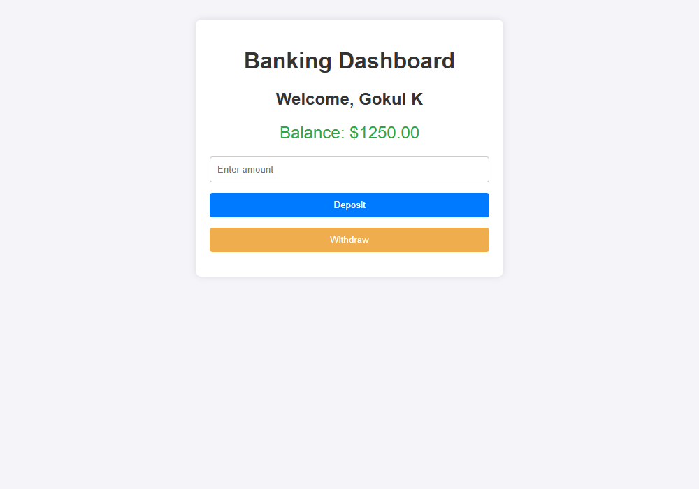

# Full Stack Banking Application (BankJS)

> **Refactored Banking Application with Express.js Backend & Interactive Frontend Dashboard**  
> **Student:** Gokul K | **Reg No:** 1P25MC013  
> **Repository:** [https://github.com/gokul479/FSD-ASS-7](https://github.com/gokul479/FSD-ASS-7)

---

## 📌 Project Title
**BankJS - Interactive Full-Stack Banking Application**

---

## 📖 Description & Motivation

### Why this project exists
Managing personal finances, tracking balances, and executing deposits or withdrawals should be intuitive, transparent, and seamless. Many existing banking learning projects either rely solely on static in-memory client state or complex enterprise frameworks that are difficult to comprehend. 

**BankJS** was engineered as a streamlined, refactored full-stack banking solution that demonstrates core financial workflows with a decoupled architecture: an **Express.js RESTful API** backend paired with a lightweight, responsive **JavaScript & HTML5** frontend.

### Whom does it help?
- **End Users & Learners:** Provides a straightforward, real-time banking interface where users can simulate opening an account, depositing funds, withdrawing cash with overdraft safeguards, and monitoring their real-time balance.
- **Developers & Evaluators:** Serves as a reference implementation for RESTful API architecture, client-server communication using the Fetch API, state synchronization, input validation, and HTTP status codes.

### What business or personal problem does it solve?
- **Balance Integrity & Overdraft Prevention:** Traditional client-only demos allow users to withdraw negative balances. This application introduces server-side transactional validation, guaranteeing that withdrawals never exceed the available balance.
- **Decoupled Architecture:** Separates backend business logic (`/api/deposit`, `/api/withdraw`, `/api/account`) from client-side presentation, making the system easy to extend, test, and integrate with persistent databases.

---

## 💻 Technology Used

The application is built using a modern full-stack JavaScript environment:

- **Backend:**
  - **Node.js**: Asynchronous event-driven JavaScript runtime environment.
  - **Express.js (v5.x)**: Fast, unopinionated minimalist web framework for building RESTful endpoints and serving static assets.
- **Frontend:**
  - **HTML5**: Semantic web markup and structured dashboard layout.
  - **CSS3**: Modern responsive styling, card layouts, smooth transitions, and mobile-friendly UI.
  - **JavaScript (ES6+)**: Asynchronous Fetch API for communication with the Express backend, dynamic DOM manipulation, and error feedback handling.
- **Version Control & Hosting:**
  - **Git & GitHub**: Version control, repository management, and deployment.

---

## 🚀 Features

### Core Implemented Features
- 👤 **Account Dashboard:** Displays the account owner's profile (`Gokul K`) and live account balance.
- 💵 **Real-Time Deposit:** Allows users to deposit positive amounts with instant server-side balance updates.
- 💳 **Secure Withdrawal Validation:** Validates withdrawal amounts against available funds to ensure zero negative balance scenarios.
- 🔔 **Interactive Feedback Alerts:** Color-coded status notifications (success alerts in green, validation errors in red).
- ⚡ **RESTful API Architecture:** Clean separation of concerns with dedicated endpoints (`GET /api/account`, `POST /api/deposit`, `POST /api/withdraw`).

### 🔮 Future Features
- 🔐 **User Authentication:** Secure user signup and login with JWT (JSON Web Tokens) or session cookies.
- 🗄️ **Database Persistence:** Integration with MongoDB / PostgreSQL to permanently persist users, accounts, and ledger records.
- 📜 **Full Transaction History Ledger:** An interactive transaction table with timestamps, transaction IDs, and running balances.
- 🔄 **Peer-to-Peer Fund Transfer:** Ability to transfer money between multiple accounts using account IDs.
- 📈 **Interest Calculator & Loan Simulator:** Financial planning modules for calculating compounding interest and loan repayments.

---

## 📸 Screenshots

### 1. Application Dashboard (Initial State)


### 2. Deposit Transaction in Action ($1,250.00 Balance)


---

## 🛠️ Installation & Setup Guidelines

Follow these step-by-step instructions to get the project up and running locally on your system:

### Prerequisites
Make sure you have [Node.js](https://nodejs.org/) (v16.x or later) and [Git](https://git-scm.com/) installed on your machine.

### Step 1: Clone the Repository
```bash
git clone https://github.com/gokul479/FSD-ASS-7.git
```

### Step 2: Navigate to the Project Directory
```bash
cd FSD-ASS-7
```

### Step 3: Install Dependencies
```bash
npm install
```

### Step 4: Start the Server
```bash
npm start
```
*Alternatively, you can run:*
```bash
node index.js
```

### Step 5: Open in Browser
Open your favorite browser and visit:
```text
http://localhost:3000
```

---

## 📄 License

This project is licensed under the **ISC License** as specified in [`package.json`](package.json).

```text
ISC License (ISC)
Permission to use, copy, modify, and/or distribute this software for any purpose with or without fee is hereby granted, provided that the above copyright notice and this permission notice appear in all copies.
```

---

## 👨‍💻 Author Information
- **Name:** Gokul K
- **Register Number:** 1P25MC013
- **Course:** Full Stack Development (FSD) - Unit 7 Assignment
- **GitHub Repository:** [gokul479/FSD-ASS-7](https://github.com/gokul479/FSD-ASS-7)
